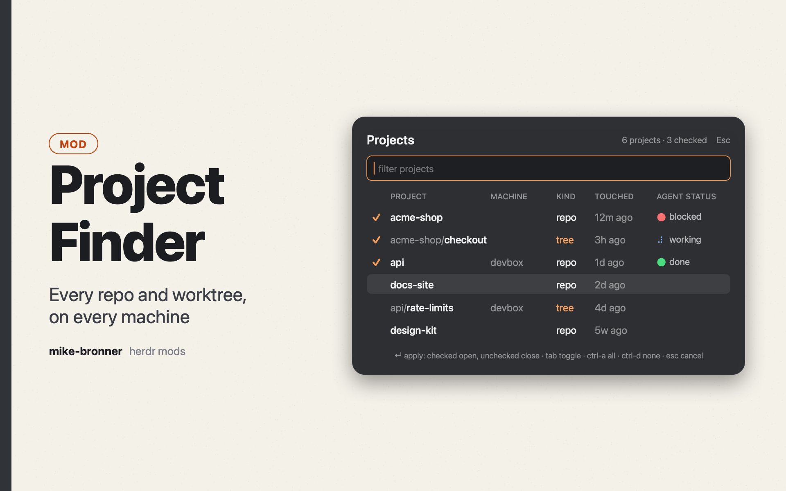

# 🔎 Project Finder for Herdr

Pick git repos and worktrees from a fuzzy list, and open them as workspaces in
[Herdr](https://herdr.dev).

Two builds live in this repo:

- **The TUI plugin**, for Herdr in the terminal.
- **The app mod** in `mods/project-finder/`, for the Herdr desktop app. The app
  does not load TUI plugins.



The preview shows six invented projects, two of them on a remote machine named
`devbox`. It is an illustration, not a screen capture.

## ✨ What it does

- Lists every git repo up to three levels under your root folder, plus their
  linked worktrees.
- Lists open projects first, already checked.
- **Enter** makes the checked rows the open set:
  - It opens newly checked projects.
  - It closes unchecked open projects, worktrees before their repositories.
  - It closes only workspaces that the list shows as rows.
- **Esc** changes nothing.
- Never lists or closes the home workspace (label `~`), or a workspace with a
  pane in your home folder.
- Holds an open repository while one of its worktrees stays checked, because
  Herdr does not close a repository with an open worktree. A held row is dim
  and says what holds it.
- Shows these columns:
  - `PROJECT`: the shortest end of the path that is unique, such as `api` or
    `group-a/api`. A worktree shows its repository first, as `sky-mill/feat-x`.
  - `KIND`: `repo` or `tree`.
  - `TOUCHED`: how long ago the project changed.
  - `AGENT STATUS`: the agent state, in the glyph and colour of the Herdr
    sidebar.
- Filters on the name, the kind (`worktree`), the age and the agent status
  (`blocked`, for example).

Worktrees are found in these places:

- Anywhere within the three levels under the root.
- `.worktrees/`, `.claude/worktrees/` and `worktrees/`, relative to each repo.
- The `[worktrees] directory` setting in your Herdr config.

## ⌨️ Keys

| Key | Does |
| --- | --- |
| any character | types into the filter, `space` included |
| `Tab` | checks or unchecks the row, then moves down |
| `Shift-Tab` | checks or unchecks the row, then moves up |
| `Ctrl-A` | checks every row the filter shows |
| `Ctrl-D` | unchecks every row the filter shows |
| `Up` / `Down`, `Ctrl-P` / `Ctrl-N` | move the cursor |
| `PageUp` / `PageDown` | move the cursor ten rows |
| `Home` / `End` | move to the first or last row |
| `Backspace`, `Ctrl-W`, `Ctrl-U` | delete a character, a word, the filter |
| `Enter` | applies what is checked |
| `Esc`, `Ctrl-C`, `Ctrl-G` | closes and changes nothing |

The app mod has no `Home`, `End`, `Ctrl-W` or `Ctrl-U` binding.

## 🧩 The TUI plugin

### Install

```sh
herdr plugin install mike-bronner/herdr-plugin-project-finder
```

- The install downloads a prebuilt picker and checks its SHA-256.
- To pin a version, add `--ref`:

```sh
herdr plugin install mike-bronner/herdr-plugin-project-finder --ref 0.9.5
```

To work on the plugin, link a checkout:

```sh
git clone https://github.com/mike-bronner/herdr-plugin-project-finder.git
herdr plugin link /absolute/path/to/herdr-plugin-project-finder
```

### Open it

Add a key to `~/.config/herdr/config.toml`:

```toml
[[keys.command]]
key = "prefix+f"
type = "shell"
command = "\"$HERDR_BIN_PATH\" plugin pane open --plugin mikebronner.project-finder --entrypoint picker"
description = "find projects"
```

To open the picker each time you start Herdr, add this to `~/.zshrc`:

```sh
herdr() {
  if [[ $# -eq 0 && -z "$HERDR_NO_PICKER" && -t 0 ]]; then
    (
      for _ in {1..200}; do
        if command herdr status server 2>/dev/null | grep -q 'status: running'; then
          out=$(command herdr plugin pane open --plugin mikebronner.project-finder --entrypoint picker 2>&1) && exit 0
          [[ $out == *ui_busy* ]] && exit 0
        fi
        sleep 0.05
      done
    ) &!
  fi
  command herdr "$@"
}
```

- `HERDR_NO_PICKER=1 herdr` starts Herdr without the picker.
- Keep the `ui_busy` check. Without it the picker can open twice.

### What a new workspace gets

- The picker opens each new workspace and hands it to the `layout` command.
- By default that command is the
  [agentic-panes-layout](https://github.com/mike-bronner/herdr-plugin-agentic-panes-layout)
  plugin. It splits the workspace into an agent, a tool pane and a shell.
- Without that plugin, each project opens as one bare pane, and one Herdr
  notification says why.
- Pairs well with
  [herdr-plugin-recent-spaces](https://github.com/mike-bronner/herdr-plugin-recent-spaces),
  which keeps the sidebar in most-recently-used order.

### Settings

Every setting is optional. Edit the plugin's own `config.toml`, not the Herdr
`config.toml`:

```sh
$EDITOR "$(herdr plugin config-dir mikebronner.project-finder)/config.toml"
```

```toml
[picker]
root = "~/code"
home = "home"
debug = true
layout = "/usr/local/bin/my-layout --space {workspace}"
```

| Key | Default | Does |
| --- | --- | --- |
| `root` | `~` | Folder to search, three levels deep. A folder that does not exist falls back to `~`. |
| `home` | `~` | Label of the home workspace, never listed or closed. |
| `debug` | `false` | Prints one line about the search to stderr. Only `true` turns it on. |
| `layout` | agentic-panes-layout, from `defaults.toml` | Command that each new workspace is handed to. |

The `layout` value:

- Is split like a shell command line, then run directly, with no shell.
- Runs detached. The picker does not read its output or exit code.
- Takes two tokens:

| Token | Becomes |
| --- | --- |
| `{workspace}` | the id of the workspace that was just opened |
| `{plugin:<id>}` | the checkout folder Herdr reports for that plugin |

- Gets your environment, minus `HERDR_PLUGIN_ROOT` and
  `HERDR_PLUGIN_CONFIG_DIR`. Export the command's own settings in your shell
  profile.
- If the command cannot run, each project opens as one bare pane, and one
  notification says why.

Each setting also has an environment variable. You can put them in a `.env`
file in the same folder:

| Key | Variable |
| --- | --- |
| `root` | `HERDR_PICKER_ROOT` |
| `home` | `HERDR_PICKER_HOME` |
| `debug` | `HERDR_PICKER_DEBUG`, any value turns it on |
| `layout` | `HERDR_PICKER_LAYOUT` |

Which value wins, first to last:

1. A variable set in the environment.
2. `config.toml`.
3. `.env`.
4. The `defaults.toml` that the plugin ships.

What happens when a file is wrong:

- An unknown key is named on stderr, and the rest of the file applies.
- A syntax error voids the whole file, and the picker uses its defaults.
- A missing file is not an error.

To see the debug line, run the picker from a shell:

```sh
HERDR_PICKER_DEBUG=1 sh bin/launcher
```

```
picker: discovery 26.9ms, 90 rows (85 from depth bands, 5 from worktree containers)
```

### Update

- A GitHub install checks for a newer release at most once a day.
- When it finds one, a dialog asks. **Enter** updates, and **Esc** says not
  now. The update takes effect at the next launch.
- A declined offer stays quiet for 24 hours.
- ⚠️ The dialog opens without warning, so an Enter meant for another pane can
  answer it.
- The dialog runs this command:

```sh
herdr plugin install mike-bronner/herdr-plugin-project-finder --ref <tag> --yes
```

To update by hand:

- A GitHub install: run the install command again.
- A linked checkout: `git pull`. The plugin never offers an update for it.
  `herdr plugin list` can show an old version for a linked plugin.

To see which binary runs:

```sh
sh bin/launcher --version
```

A `STALE:` line says whether to rebuild or reinstall.

### Requirements

- Nothing on macOS, Linux or Windows, on x86-64 or arm64.
- A Rust toolchain only when no prebuilt picker can be used, such as a
  checkout with local changes or no network. Today the build needs Rust 1.85
  or newer.
- To always compile, create an empty `BUILD_FROM_SOURCE` file in the plugin
  folder.

### ⚠️ Windows

- Windows builds are published, but nobody has run one.
- The picker pane runs `sh bin/launcher`, so `prefix+f` does not work on
  Windows.
- Name a `layout` command in full, extension included, or give an absolute
  path. `PATHEXT` is not read.
- The `layout` command may not outlive the picker on Windows.

## 🖥️ The app mod

### Install

Your Herdr agent can install it: give it this repo's address. To install it
yourself:

1. Make sure `~/.config/herdr-app/mods/project-finder` does not exist.
2. Run:

```sh
git clone https://github.com/mike-bronner/herdr-plugin-project-finder.git
cp -R herdr-plugin-project-finder/mods/project-finder ~/.config/herdr-app/mods/project-finder
herdr-app check ~/.config/herdr-app/mods/project-finder
```

- Keep the folder name `project-finder`. The mod reads its settings from its
  own `mod.json` there.
- To update, install it again. A new copy resets your settings.

### Open it

- From the command palette: **Find projects**.
- From a key: copy the binding in this repo's `keys.json` into
  `~/.config/herdr-app/keys.json`. It binds `cmd-shift-o`.

### How it differs from the TUI plugin

- Lists projects on this computer and on every remote machine connected to the
  app.
  - The `MACHINE` column is blank for this computer.
  - The filter matches machine names.
  - Enter opens and closes spaces on each row's own machine.
  - A machine that cannot be searched is skipped, with a line such as
    `Skipped devbox: unavailable`.
- Keeps the last list, shows it at once on the next open, and refreshes each
  machine in the background. Your checks and filter stay during a refresh.
- Matches a space to a project by the folder of its first terminal, not by
  name.
- Opens a new space as a plain shell, or starts an agent if you set one. The
  TUI's `layout` command and update offer do not exist here.
- Reads worktree folders from `worktrees.directory` in
  `~/.config/herdr-app/settings.json`. The default is `~/.herdr/worktrees`.

### Settings

Edit `settings` in `~/.config/herdr-app/mods/project-finder/mod.json`. The app
reloads the mod on save.

```json
"settings": { "root": "~/code", "machineRoots": { "devbox": "~/work" }, "agent": ["claude"] }
```

| Setting | Default | Does |
| --- | --- | --- |
| `root` | `~` | Folder to search on every machine. `~` is each machine's own home. A missing folder falls back to home. |
| `machineRoots` | none | A root for one remote machine, by name, in place of `root`. |
| `agent` | `null` | Program each new space starts, as a list of words, such as `["claude"]`. `null` is a plain shell. |

A setting of the wrong type shows at the top of the popup, and Enter then
changes nothing.

### Requirements

- `find`, `sh`, `stat`, `awk` and `test` on every machine it searches.
- No network apart from the app's own connections to its machines.

## 🧪 Tests

TUI plugin:

```sh
cargo test
cargo fmt --check
cargo clippy --all-targets
```

App mod:

```sh
node --test tests/app-mod/discover.test.mjs tests/app-mod/picker.test.mjs tests/app-mod/remote.test.mjs tests/app-mod/cache.test.mjs
herdr-app check mods/project-finder
```

- `herdr-app check` writes `jsconfig.json` and `gpui-kit.d.ts` into the mod
  folder. `.gitignore` keeps them out of the repo.
- CI also runs the herdr-plugin-kit checks, with the kit checked out beside
  this repo:

```sh
python3 ../herdr-plugin-kit/templates/sync_bin.py . --check
python3 ../herdr-plugin-kit/tools/plugin_gate.py versions .
python3 ../herdr-plugin-kit/tools/plugin_gate.py pin-block .
```

- Before a release, run `herdr plugin list --json` against a live Herdr.
  Check that this plugin has no `warnings` and shows the version in
  `herdr-plugin.toml`.
