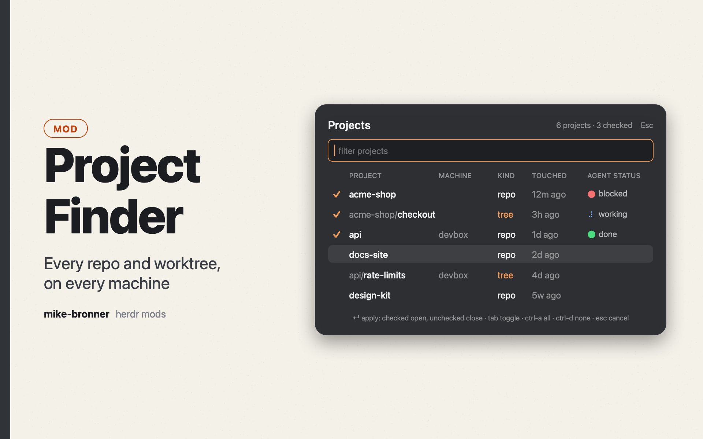

# Project Finder

A popup that lists every git repository up to three levels under a root folder, plus the linked worktrees that belong to them, and makes the checked rows the set of open spaces. Open projects are listed first and already checked. Type to filter, Tab to check or uncheck, Enter to apply: newly checked projects open as spaces in their folders, and unchecked open ones close. Esc changes nothing. The home space (`~`) is never listed and never closed.

## What you see

- **A popup** at the top of the window, 40px down, 780px wide, as tall as its content and at most 80% of the window high, on the theme's `popover` color, with 16px padding and 10px between its parts. Text is 13px in the layout's UI font.
- **The title line:** `Projects` at 15px semibold in `foreground`. On the right, a summary at 11px in `dim`, such as `42 projects · 3 checked · 1 held` (`7/42 projects` while a filter hides rows, and no `held` part when nothing is held), then an `Esc` button at 11px in `dim` that turns `foreground` on `hover` when pointed at.
- **The filter field:** 32px high, 6px corners, on `background`, with a 1px border in `accent` while it has the keyboard and `input` otherwise. Placeholder `filter projects`.
- **Setting problems**, one line each in `blocked`, such as `Setting: agent must be null or a list of words, such as ["claude"]`, and an error line in `blocked` when there is one.
- **While it looks:** a braille spinner and `Finding projects…` in `muted`, turning every 90 ms. When the search fails, its error line takes the spinner's place.
- **The column headings** at 11px in `dim`: a 14px gap for the mark, `PROJECT` taking the rest, then `KIND` (40px), `TOUCHED` (72px) and `AGENT STATUS` (112px).
- **One row per project**, 28px high, 6px corners, 10px apart inside:
  - A `✓` in `accent` when checked, nothing when not.
  - The project name. A worktree row puts its repository's name and a `/` in front, in `dim`, such as `acme-shop/` before `checkout`. The letters the filter matched are `accent` and bold.
  - `KIND`: `tree` in `accent` for a linked worktree, `repo` in `foreground` for a repository.
  - `TOUCHED`: how long ago the newest file changed, in `dim`: `12m ago`, `3h ago`, `2d ago`, `5w ago`, or `-` when there are no files.
  - `AGENT STATUS` for an open project: a glyph, then the status word at 12px in `muted`.
- **The list** is as tall as its rows, up to 16 rows (448px), and scrolls past that with a scrollbar. When the filter leaves no rows, it is 44px high and shows `No matching projects.` in `dim`. The keys scroll the row they act on into view.
- **The row the keys act on** has the `selected` background. Other rows show `hover` under the pointer.
- **A held row** draws its name in `dim` and puts `held by checked worktrees` (12px, `dim`, 240px) where `KIND`, `TOUCHED` and `AGENT STATUS` would be.
- **The footer**, right-aligned, 11px, `dim`: `↵ apply · tab toggle · ctrl-a all · ctrl-d none · esc cancel` and `checked = open · unchecked open projects close on ↵`.

## How it behaves

- **Agent status** is the most urgent status of the spaces open on that project (blocked, then done, then working, then idle):
  - **working:** a braille spinner in `working`, turning every 90 ms.
  - **blocked:** `●` in `blocked`.
  - **done:** `●` in `done`.
  - **idle:** `○` in `idle`.
  - A project that is not open, or is open with no agent, shows nothing there.
- **Which rows:** every folder up to three levels under the root that holds a `.git`, never entering a folder whose name starts with a dot. A repository inside another listed repository is skipped. Worktrees are then looked for one and two levels inside each repository's containers: `.worktrees`, `.claude/worktrees`, `worktrees`, and the app's `worktrees.directory` setting. A relative setting is resolved against each repository, and an absolute or `~` one is searched as it is, even outside the root. Without the setting, the app's own default `~/.herdr/worktrees` is searched. Only a real linked worktree (a `.git` file) is listed from a container.
- **Names:** a row is named by as much of the end of its path as it takes to be the only row with that name: two `api` folders under `group-a` and `group-b` read `group-a/api` and `group-b/api`. A name longer than 34 characters is cut with `…`, and the repository prefix gives up its own characters first.
- **Order:** projects with an open space come first, in the spaces sidebar's order, already checked. The rest follow, most recently touched first.
- **Open means** a space on this computer whose first terminal is inside the project folder, or that was made there. The deepest listed folder wins, so a space in a worktree is that worktree's, not its repository's. Spaces on other machines are never listed as open and never closed.
- **Keys:** typing filters. `Tab` checks or unchecks the highlighted row and moves down, `Shift-Tab` moves up. `Ctrl-A` checks every row the filter left, `Ctrl-D` unchecks them. `Up`/`Down`, `Ctrl-P`/`Ctrl-N` and `PageUp`/`PageDown` move. `Enter` applies. `Esc`, `Ctrl-C` and `Ctrl-G` close and change nothing. A click on a row checks or unchecks it.
- **The filter** is fuzzy: each word must match its letters in order, in the name, the kind word (`repo` or `worktree`), the age and the status word. Lowercase matches any case, and an uppercase letter makes that word exact. Better matches come first.
- **Holding:** an open repository is held while any of its own worktree rows is checked. A held row will not uncheck. Checking a worktree also checks its open repository. Unchecking the last checked worktree frees it. A repository that is not open holds nothing, and checking its worktree never opens it. `Ctrl-D` unchecks worktrees before repositories, so a repository and its worktrees clear together.
- **Enter:** closes every open space on an unchecked row, worktrees before repositories, with `space.close` confirmed. It never closes the home space or a space with a terminal at home. Then it opens every newly checked project with `space.new` in its folder on this computer. Only the last one opens in front. When nothing opened and the shown space closed, it shows the first space that stayed, else the home space. A close that fails does not stop the other closes. A space that fails to open stops the remaining opens and selects nothing. A select that fails is ignored, as the TUI ignores a failed focus. Every failed close and open is reported in one warning toast.
- **The agent setting:** with `"agent": ["claude"]`, each new space starts `claude` in its first tab. With `null`, it is a plain shell.
- **A setting problem** is shown at the top, and Enter then changes nothing.
- **Nothing moves** apart from two spinners: the `Finding projects…` spinner while the list loads, and the working spinner beside an agent that is working.

## Built from

- `mods/project-finder/mod.json`: `{ "place": "none", "title": "Project Finder", "overlay": { "kind": "popup", "at": "top", "offset": 40, "width": 780, "height": 0.8 }, "palette": [{ "title": "Find projects", "command": "mod.open", "args": { "name": "project-finder" }, "words": "…" }], "settings": { "root": "~", "agent": null } }`. It docks nowhere. `mod.open {name: "project-finder"}` opens it, from the palette entry or a key.
- `keys.json`: `{ "global": { "cmd-shift-o": "mod.open:project-finder" } }`.
- `mods/project-finder/discover.js`: pure functions, no `herdr` import. `discover({root, dirs, roots}, run)` runs three programs through `run`:
  1. `find -L <root> -mindepth 1 -maxdepth 4 ( -name .git -prune -print ) -o ( -name '.*' -prune )` for the repositories, in three depth bands, each sorted by path, nested ones skipped.
  2. `find -L <containers…> -mindepth 1 -maxdepth 3 ( -name .git -prune -type f -print ) -o ( -name '.*' -prune )` for the worktrees in the containers.
  3. One `sh -c` script, built by `factsScript`, that prints for each row its kind, the first line of a worktree's `.git` pointer, and the newest mtime of `.git/index` and of the files three levels down. That walk skips `node_modules`, `vendor` and `.git` folders and the row's own containers. It uses `stat -L -c %Y` or `stat -L -f %m`, whichever works, and `awk` keeps the newest.

  Also `parentRepo` (the repository from `gitdir: <repo>/.git/worktrees/<name>`), `labelled`, `tails`, `humanAge`, `elide`, `normpath` and `worktreeLocations`.
- `mods/project-finder/picker.js`: pure functions, no `herdr` import. `readSettings`, `openSpaces`, `homeSpaceIds`, `buildEntries`, `held`, `toggle`, `setAll`, `fuzzy`, `filtered`, `rowCells`, `listHeight`, `plan`, `pickFocus` and `applySelection`, which runs the Enter commands through the `run` it is given and returns every close and open that failed.
- `mods/project-finder/main.js`: the view. From `herdr`: `spaces`, `panes`, `run`, `exec`, `home`, `appHome`, `theme`, `props`, `closeOverlay`, `readTextFile`, `notify`, `checking`. From `gpui-base`: `v_flex`, `h_flex`, `InputState`, `Input`, `ScrollHandle`, `Scrollbar`. It reads `mods/project-finder/mod.json` for its settings and `settings.json` for `worktrees.directory`, checks the root with `test -d` (falling back to home), and runs `space.close {id, confirmed: true}`, `space.new {folder, machine: "", argv?, focus}` and `space.select {id}`.
- No art and no other shipped mod.

## Watch out

- It runs programs: `find`, `sh`, `stat`, `awk` and `test`, all on this computer. It reads files only under the root and the worktree containers, plus its own `mod.json` and the app's `settings.json`.
- The mod reads its settings from `mods/project-finder/mod.json`, so the folder must keep that name. A reinstall that copies the folder again resets the settings.
- On macOS, searching the home folder can make the system ask whether Herdr may read Desktop, Documents or Downloads. Point `root` at a code folder to avoid it.
- `space.new` gives back no id, so the focus rule picks the new space by opening only the last one with `focus: true`.
- Open spaces are matched by folder, not by name, and spaces are left unnamed so they follow their folder. A symlinked root whose terminals report the resolved path does not match.
- The filter has no special syntax: `^`, `$`, `'` and `!` are plain letters.
- `herdr-app check` renders only the loading state, because `init` returns early while checking.

## Done when

- `herdr-app check mods/project-finder` reports no errors.
- `node --test tests/app-mod/discover.test.mjs tests/app-mod/picker.test.mjs` passes.
- With `root` pointing at a folder holding `acme-shop` and `acme-shop/.worktrees/acme-shop/checkout`, the popup lists `acme-shop` as `repo` and `acme-shop/checkout` as `tree`.
- Checking a row and pressing Enter opens a space in that folder. With `"agent": ["claude"]`, Claude Code starts in its first tab.
- Unchecking an open worktree and its repository and pressing Enter closes the worktree's space first, then the repository's.
- Esc closes the popup and every space stays as it was.
- The `~` space is never a row and stays open whatever is checked.
